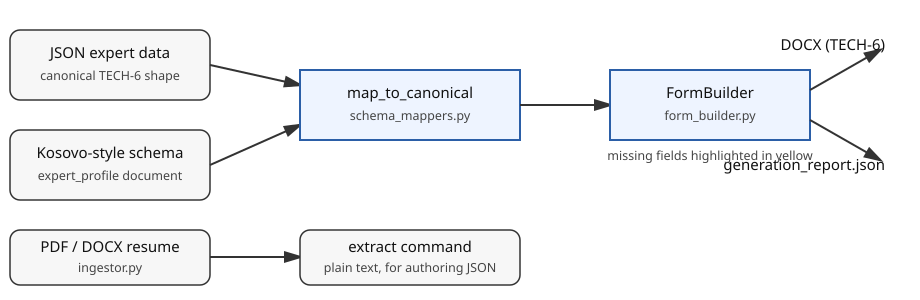

# tech6-cv-generator

Turn structured JSON into a filled-in TECH-6 CV document — without retyping the same form by hand for every expert.

## Description

`tech6-cv-generator` is a Python CLI and library that generates
TECH-6 curriculum vitae documents (`.docx`) from structured JSON.
TECH-6 is the CV form used in technical proposals for consulting
assignments procured by multilateral development banks, including the
World Bank and the Asian Development Bank. This tool is not affiliated
with or endorsed by any of them; it just produces documents in that
shared form's layout.

Given a JSON file describing an expert — name, position, education,
employment record, languages, and so on — it produces a formatted
`.docx` in the TECH-6 layout, with personal info, education,
employment records, memberships and languages, an adequacy table,
contact and certification, and signature blocks.

Two behaviours define the tool:

- **Missing fields are highlighted in yellow** in the document, so
  gaps are visible at a glance instead of slipping into a submitted
  proposal. The builder's report counts every highlight.
- **Batch runs end with a `generation_report.json`** saying what
  succeeded, what failed, and what was highlighted. One bad input
  does not kill the run, and the process exits non-zero if anything
  failed.

It can also map a differently-shaped schema into TECH-6 first — the
included example is a Kosovo-style schema with an `expert_profile`
block — and extract plain text from PDF or DOCX resumes to help
populate the data.



## Prerequisites

- **Python 3.10 or later** (CI tests 3.10, 3.11, 3.12, and 3.13).
- `pip` for installation.
- `git` only if you want to clone the repository rather than use a
  downloaded copy.
- Optional, for rendering screenshots of generated documents (not
  needed to use the tool): LibreOffice and `pdftoppm`. See
  `docs/assets/README.md`.

## Installation

This package is **not published on PyPI** yet, so install it from a
local copy of the repository:

```bash
git clone https://github.com/enonymous1/tech6-cv-generator.git
cd tech6-cv-generator
pip install .
```

Verify the install:

```bash
tech6-cv-generator --version
# tech6-cv-generator 2.1.0
```

For development work (tests, linting), install with the dev extras
instead — see [Local Development](#local-development).

## Quick start

Generate one CV from the fictional sample data:

```bash
tech6-cv-generator generate examples/sample_data.json
# -> outputs/Form_TECH-6_CV_Jane_Q._Expert.docx
# -> outputs/generation_report.json
```

<!-- Screenshot placeholder: docs/assets/sample-output.png — first page of
the generated Jane Q. Expert DOCX, rendered from a real run via LibreOffice.
Capture it as described in docs/assets/README.md, then remove these comment
markers. Do not substitute a mockup. -->

Generate a whole folder at once:

```bash
tech6-cv-generator generate my-experts/ --output-dir outputs/
```

Map a schema file to TECH-6 JSON before generating:

```bash
tech6-cv-generator map examples/tech6_kosovo_schema.json --output mapped.json
tech6-cv-generator generate mapped.json
```

Or map a whole directory of schemas into your inputs first, with
`generate --schema-dir`:

```bash
tech6-cv-generator generate my-experts/ --schema-dir my-schemas/
```

Extract text from a resume (PDF or DOCX), for example to help author
the JSON:

```bash
tech6-cv-generator extract examples/sample_resume.docx
```

### Output rules worth knowing

- An existing output file is **never overwritten**: a numeric suffix
  is appended instead (`..._2.docx`, `..._3.docx`).
- If no name is present (or it is a placeholder such as
  `{Insert full name}`), the output filename falls back to the input
  file's stem (`Form_TECH-6_CV_<stem>.docx`).
- Filenames are sanitized: an expert name containing path separators
  cannot write outside the output directory.
- Exit codes: `0` when everything succeeded, `1` when any input
  failed (the rest still ran), `2` for usage errors such as a missing
  input path or an unsupported file type for `extract`.

### How missing fields are flagged

When a personal-info field, a contact field, or an employment
reference is missing, a placeholder, or (for references) marked
"available on request" without contact details, the corresponding text
is shaded yellow and recorded in the report. A complete record, like
the sample data, produces no highlights at all.

<!-- Screenshot placeholder: docs/assets/highlighted-fields.png — close-up
of a personal-info table with yellow-highlighted missing fields, from a
real run on an incomplete record. Capture it as described in
docs/assets/README.md, then remove these comment markers. -->

### Library use

```python
import json
from tech6_cv_generator import FormBuilder, map_to_canonical

data = json.load(open("examples/sample_data.json"))
out = FormBuilder(data).build(output_dir="outputs")
print(out)

mapped = map_to_canonical(json.load(open("examples/tech6_kosovo_schema.json")))
```

A builder may be reused: each `build()` call starts from a fresh
document and report, so two builds produce two identical documents.

## Local Development

Set up an isolated environment and install with dev extras:

```bash
python3 -m venv .venv
source .venv/bin/activate
pip install -e ".[dev]"
```

Run the checks:

```bash
pytest -q            # test suite (21 tests)
ruff check src tests # lint
make generate-sample # generate the fictional sample into ./outputs
```

<!-- Demo GIF placeholder: docs/assets/demo.gif — terminal recording of
`tech6-cv-generator generate examples/sample_data.json` and the resulting
outputs/ listing. Record it as described in docs/assets/README.md, then
remove these comment markers. -->

### Project layout

- `src/tech6_cv_generator/form_builder.py` — builds the TECH-6
  document: personal info, education, employment records, memberships
  and languages, adequacy table, contact and certification,
  signatures. Missing personal/contact fields get yellow highlighting
  and are recorded in the builder's report.
- `src/tech6_cv_generator/docx_helpers.py` — the single place that
  knows the low-level python-docx XML for highlighting, cell borders
  and margins, and paragraph borders.
- `src/tech6_cv_generator/schema_mappers.py` — normalizes dates,
  contacts, and languages, and maps Kosovo-style and flat schemas
  into the canonical TECH-6 shape.
- `src/tech6_cv_generator/orchestrator.py` — batch generation with a
  structured report; one bad file no longer kills the whole run.
- `src/tech6_cv_generator/ingestor.py` — PDF (pdfplumber) and DOCX
  text extraction, and JSON input listing.
- `src/tech6_cv_generator/cli.py` — the `tech6-cv-generator`
  command: `generate`, `map`, `extract`.
- `examples/` — fictional sample data only (Jane Q. Expert,
  example.com addresses), the TECH-6 schema and its documentation,
  and a Kosovo-style schema template with placeholder names.
- `docs/REVIEW.md` — the staff-level review of v2.0.0 and the fixes
  applied in v2.1.0, including what was deliberately deferred and why.

### Verifying a change without breaking generated output

The generated document is the product, so a change that alters it
should be a deliberate decision, not an accident. After touching the
builder or mappers, generate the sample and compare its paragraph and
table text against the previous version (the v2.1.0 review did exactly
this against v2.0.0). New behaviour needs a test in `tests/` that pins
it — see `tests/test_staff_review_fixes.py` for the pattern.

## Deployment

There is no hosted service to deploy: this is a command-line tool and
library, not a web application, so there is no server, database, or
GitHub Pages site involved.

Releasing a new version means:

1. Bump the version in `pyproject.toml` and
   `src/tech6_cv_generator/__init__.py`, and add a `CHANGELOG.md`
   entry.
2. Commit and push to `main`. GitHub Actions runs ruff and pytest on
   Python 3.10–3.13 (see `.github/workflows/ci.yml`).
3. Tag the release (`git tag v2.1.0 && git push origin v2.1.0`) and
   create a GitHub release from the tag.

Publishing to PyPI is not configured yet. Until it is, users install
from the repository as described in [Installation](#installation);
do not publish under the package name without checking that the name
is free and adding a publish workflow first.

## A note on the data in this repo

This is a cleaned public export. The original project contained real
experts' CV data and generated documents; none of that is in this
repository. Every example here is fictional, generated outputs are
git-ignored, and the original private history is not included — see
`CHANGELOG.md`.

## License

MIT — see `LICENSE`.
